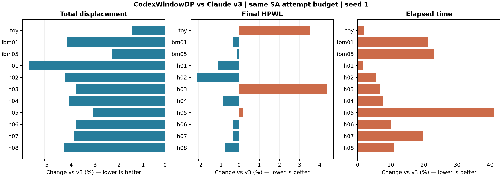
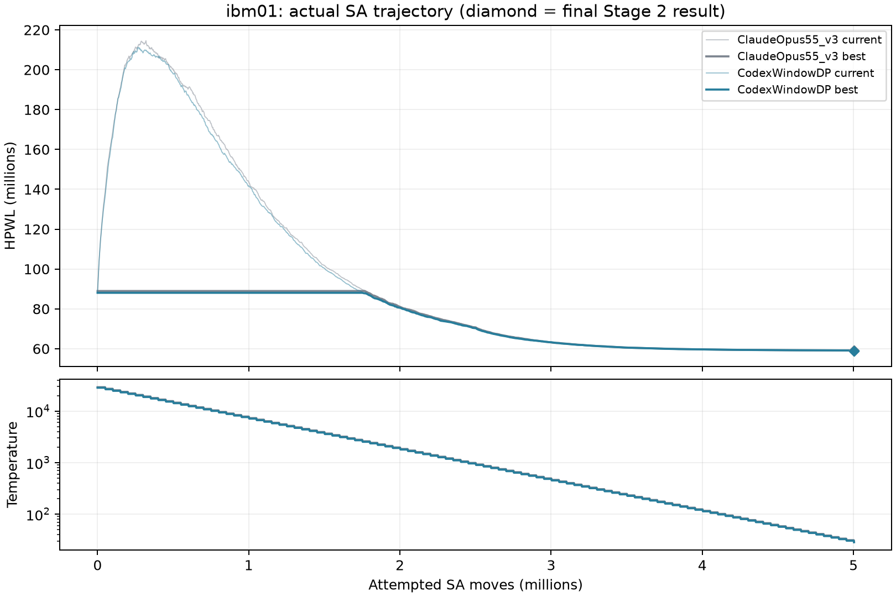

# 六個版本的完整比較與仍可改良之處

全部 **66/66** 次測試通過獨立 checker。相對 v3，WindowDP 的總位移幾何平均降低 **3.63%**，最大位移全部不增加；最終 HPWL 幾何平均增加 **0.20%**，**8/11** 筆較好。這是固定搜尋預算、seed 1 的比較，不是官方分數或統計顯著性結論。

本次 11 筆總位移都是六個版本最低；HPWL 的 3 筆退步是 toy、h03、h05，因此不能宣稱全面優於 v3。新版總時間相對 v3 的幾何平均增加 13.08%。



## 共同實驗條件

- 2026-10-19，本機循序執行；每版相同 `g++ -std=c++17 -O2 -Wall -Wextra`。沒有同時跑多個 placement 程序；時間是單次本機量測，會受系統負載影響。
- 每個 benchmark 的 `K=max(200,ceil(5000000/Nmovable))`，六版均傳入 `--effort K --time 1000 --seed 1`。因此約 500 萬次，ibm05 約 563 萬次。舊版溫度迴圈取整到 100 的倍數，與 GapSA 的次數差小於 100。
- `--time 1000` 只用來避免依機器速度截斷搜尋；不是每筆真的跑 1000 秒。各版額外收尾與每次 proposal 工作不同，所以同 attempts **不是同 CPU 時間**；時間另列。
- 11 筆＝3 筆課程資料＋8 筆合成 holdout；holdout 不是 TA 官方隱藏測資。
- 每筆檢查 7 個輸出檔、4 行 stdout、兩個 placement 的 row/site/subrow/重疊/fixed/orientation、獨立計算指標、最終 HPWL 不高於該版本合法化結果。
- 原始資料在 `../../Testcases/results/CodexWindowDP/comparison/records.csv`；編譯器與所有 `.cpp/.hpp` SHA-256 在 `settings.json`；每次 stdout/stderr、trace、輸出及 checker 結果均保留。
- 本次重跑全部版本，未混入根目錄 `../COMPARISON.md` 的預設 effort 測試。那份表中 v3 額外給較多 SA 次數，不能與本表直接相減。

## 四項指標（越低越好）

### 總位移

| 測資 | v1 | GapSA | v2 | ParetoDP | v3 | WindowDP |
|---|---:|---:|---:|---:|---:|---:|
| toy | 46,619.20 | 49,378.40 | 44,375.60 | 44,375.60 | 44,375.60 | **43,769.00** |
| ibm01 | 27,235,500.80 | 46,210,453.44 | 25,452,360.15 | 25,414,553.07 | 25,359,086.09 | **24,326,593.84** |
| ibm05 | 1,431,841.69 | 2,115,318.81 | 1,418,381.54 | 1,415,891.57 | 1,405,267.09 | **1,374,188.25** |
| h01 | 2,575.61 | 3,018.59 | 2,528.05 | 2,528.05 | 2,528.05 | **2,385.27** |
| h02 | 534,211.04 | 746,007.58 | 526,483.91 | 526,432.11 | 526,483.91 | **504,642.96** |
| h03 | 8,477.19 | 15,242.97 | 7,844.45 | 7,840.01 | 7,808.98 | **7,518.89** |
| h04 | 203,183.03 | 458,666.49 | 207,438.05 | 207,314.67 | 203,875.53 | **195,745.71** |
| h05 | 1,658,809.00 | 1,918,908.54 | 1,646,497.72 | 1,646,497.72 | 1,646,497.72 | **1,597,116.07** |
| h06 | 1,075,555.10 | 2,008,911.04 | 1,112,305.62 | 1,111,243.50 | 1,092,397.96 | **1,052,031.40** |
| h07 | 124,696.10 | 239,840.46 | 125,425.74 | 125,229.16 | 123,078.84 | **118,403.08** |
| h08 | 157,049,936.00 | 310,239,009.07 | 150,496,293.33 | 150,041,838.18 | 146,044,300.09 | **139,934,750.54** |
| 相對 v3 幾何平均 | 1.0304 | 1.6196 | 1.0093 | 1.0084 | 1.0000 | 0.9637 |

### 最大位移

| 測資 | v1 | GapSA | v2 | ParetoDP | v3 | WindowDP |
|---|---:|---:|---:|---:|---:|---:|
| toy | **1,987.60** | 2,369.10 | 2,007.90 | 2,007.90 | 2,007.90 | 2,007.90 |
| ibm01 | **10,578.29** | 25,242.46 | 10,620.95 | 10,620.07 | 10,620.36 | 10,618.21 |
| ibm05 | 217.61 | 559.79 | **202.75** | **202.75** | **202.75** | **202.75** |
| h01 | 33.07 | 52.61 | **31.67** | **31.67** | **31.67** | **31.67** |
| h02 | 2,727.93 | 4,956.52 | **2,607.30** | **2,607.30** | **2,607.30** | **2,607.30** |
| h03 | 21.61 | 35.22 | **21.16** | **21.16** | **21.16** | **21.16** |
| h04 | 296.70 | 677.94 | **241.57** | **241.57** | **241.57** | **241.57** |
| h05 | **1,398.41** | 1,880.31 | 1,494.99 | 1,494.99 | 1,494.99 | 1,494.99 |
| h06 | 504.20 | 845.23 | **435.22** | **435.22** | **435.22** | **435.22** |
| h07 | 52.96 | 97.70 | **48.03** | **48.03** | **48.03** | **48.03** |
| h08 | 29,576.64 | 71,526.95 | **28,600.48** | **28,600.48** | **28,600.48** | **28,600.48** |
| 相對 v3 幾何平均 | 1.0545 | 1.9345 | 1.0000 | 1.0000 | 1.0000 | 1.0000 |

### Stage 2 最終 HPWL

| 測資 | v1 | GapSA | v2 | ParetoDP | v3 | WindowDP |
|---|---:|---:|---:|---:|---:|---:|
| toy | 46,848.00 | 45,828.00 | 47,514.00 | 46,506.00 | **45,060.00** | 46,644.00 |
| ibm01 | 68,713,950.00 | 74,490,990.00 | 60,189,774.00 | 59,727,960.00 | 59,135,388.00 | **58,958,256.00** |
| ibm05 | 11,629,743.00 | 11,200,985.50 | 11,061,412.50 | 10,964,312.50 | 10,879,403.00 | **10,865,913.50** |
| h01 | 14,066.50 | 14,008.00 | 14,194.50 | 14,127.50 | 14,146.00 | **14,000.50** |
| h02 | 2,346,385.00 | 2,447,019.80 | 2,322,805.30 | 2,334,372.70 | 2,358,148.40 | **2,309,360.10** |
| h03 | 12,818.90 | 14,638.10 | 12,470.80 | 12,467.30 | **12,193.00** | 12,724.50 |
| h04 | 265,325.50 | 295,345.00 | 238,610.50 | 238,407.50 | 238,358.00 | **236,428.00** |
| h05 | 18,749,360.10 | 19,126,237.90 | 18,862,485.50 | 18,607,826.40 | **18,527,571.80** | 18,560,211.50 |
| h06 | 1,052,231.00 | 1,043,442.50 | 744,957.50 | 748,872.00 | 741,363.00 | **739,243.00** |
| h07 | 211,122.64 | 205,002.54 | 179,200.98 | 177,191.61 | 175,984.79 | **175,423.91** |
| h08 | 212,100,780.90 | 167,069,243.80 | 118,381,314.30 | 115,802,755.60 | 115,699,901.20 | **114,865,389.50** |
| 相對 v3 幾何平均 | 1.1516 | 1.1560 | 1.0149 | 1.0075 | 1.0000 | 1.0020 |

### 總時間（秒，含所有最佳化及 I/O）

| 測資 | v1 | GapSA | v2 | ParetoDP | v3 | WindowDP |
|---|---:|---:|---:|---:|---:|---:|
| toy | **0.99** | 3.56 | 1.06 | 1.10 | 1.41 | 1.43 |
| ibm01 | **3.26** | 10.51 | 9.32 | 9.75 | 10.52 | 12.75 |
| ibm05 | **8.06** | 23.62 | 17.53 | 18.63 | 23.20 | 28.52 |
| h01 | **1.60** | 3.69 | 1.73 | 1.75 | 2.00 | 2.03 |
| h02 | **1.78** | 4.46 | 1.93 | 1.96 | 2.20 | 2.32 |
| h03 | **1.88** | 5.21 | 3.31 | 3.39 | 3.68 | 3.93 |
| h04 | **2.60** | 6.92 | 6.96 | 7.16 | 7.62 | 8.21 |
| h05 | **2.31** | 8.15 | 2.45 | 2.60 | 2.80 | 3.95 |
| h06 | **5.37** | 11.09 | 13.61 | 14.02 | 16.54 | 18.21 |
| h07 | **4.07** | 12.56 | 10.95 | 11.51 | 13.88 | 16.61 |
| h08 | **7.57** | 19.84 | 27.57 | 28.44 | 38.26 | 42.42 |
| 相對 v3 幾何平均 | 0.4442 | 1.2469 | 0.8301 | 0.8603 | 1.0000 | 1.1308 |

## 新版改善來源：同一次執行的逐階段記錄

此表不另換 seed，也沒有增加 SA 次數；用各階段日誌隔離新增方法的直接效果。位移用精確內部值，HPWL 的 SA 前後值來自 `[polish-total]`。

| 測資 | v3 總位移 | 新版總位移 | 降幅 | 新版合法化 HPWL | 新版純 SA HPWL | 新版收尾後 HPWL |
|---|---:|---:|---:|---:|---:|---:|
| toy | 44,375.60 | 43,769.00 | 1.37% | 111,684.00 | 47,106.00 | 46,644.00 |
| ibm01 | 25,359,086.09 | 24,326,593.84 | 4.07% | 88,059,084.00 | 59,134,914.00 | 58,958,256.00 |
| ibm05 | 1,405,267.09 | 1,374,188.25 | 2.21% | 11,855,384.50 | 10,909,591.00 | 10,865,913.50 |
| h01 | 2,528.05 | 2,385.27 | 5.65% | 25,407.00 | 14,008.50 | 14,000.50 |
| h02 | 526,483.91 | 504,642.96 | 4.15% | 3,834,538.10 | 2,312,441.10 | 2,309,360.10 |
| h03 | 7,808.98 | 7,518.89 | 3.71% | 26,850.60 | 12,739.80 | 12,724.50 |
| h04 | 203,875.53 | 195,745.71 | 3.99% | 536,519.00 | 236,706.50 | 236,428.00 |
| h05 | 1,646,497.72 | 1,597,116.07 | 3.00% | 26,229,349.10 | 18,623,996.50 | 18,560,211.50 |
| h06 | 1,092,397.96 | 1,052,031.40 | 3.70% | 2,064,430.50 | 743,105.00 | 739,243.00 |
| h07 | 123,078.84 | 118,403.08 | 3.80% | 351,696.93 | 176,876.36 | 175,423.91 |
| h08 | 146,044,300.09 | 139,934,750.54 | 4.18% | 297,097,737.90 | 117,967,317.30 | 114,865,389.50 |



高溫時 current HPWL 上升是 SA 接受 uphill moves 的結果；best-so-far 保留原本較佳解，之後隨降溫降低。圖上的菱形才是包含確定性收尾的 Stage 2 最終值，沒有把收尾冒充 SA iterations。

## 多 seed 檢查

seed 1 使用完整比較的結果；另外重跑 seed 2、3。只對 v3 與新版、5 個案例測量，所以不能外推為全測資多 seed 結論。標準差為 sample standard deviation。

| 測資 | v3 HPWL 平均 ± 標準差 | WindowDP 平均 ± 標準差 | 平均降幅 | 逐 seed 勝場 |
|---|---:|---:|---:|---:|
| toy | 45,942.00 ± 785.45 | 46,644.00 ± 534.00 | -1.53% | 1/3 |
| h01 | 14,146.17 ± 88.75 | 14,000.50 ± 2.00 | 1.03% | 3/3 |
| h02 | 2,342,599.60 ± 27,781.45 | 2,316,935.23 ± 18,143.45 | 1.10% | 2/3 |
| h03 | 12,317.37 ± 217.40 | 12,433.03 ± 265.46 | -0.94% | 1/3 |
| ibm01 | 59,019,102.00 ± 131,658.85 | 58,945,930.00 ± 144,254.50 | 0.12% | 2/3 |

## 已經最佳了嗎？

**沒有。** 新 DP 只證明選定小視窗內的位移子問題最佳；全域最大位移、完整 row 分配及 HPWL 都未證明最佳。

對 toy、h01，另以完整列枚舉的整數規劃檢查相同最大位移上限下的最小總位移。數值最佳／下界是雙精度求解器容差內的證書；大型設計未做全域證明。

| 測資 | 新版總位移 | 最大位移上限 | 完整 ILP 最佳／已知解 | 比該解高出 | 最大位移 LP 下界 |
|---|---:|---:|---:|---:|---:|
| toy | 43,769.00 | 2007.9000 | 42,890.20（證明） | 2.049% | 1938.3974 |
| h01 | 2,385.27 | 31.6700 | 2,295.79（僅已知解） | 3.898% | 26.4799 |

toy 的完整 ILP incumbent 與 dual bound 都是 42,890.2，已在零 MIP gap 下證明。h01 在 120 秒 MIP 上限內找到 2,295.79，dual bound 為 2,281.57，**尚未證明最優**；其最優總位移位於兩者之間，不能再引用原先受限模型的 2,383.6 作全域最佳值。
最大位移 LP 下界是有效的下界，但不是整數最優值：toy 約 1,938.40，h01 約 26.48。因此現有 2,007.9／31.67 並不能據此宣稱只差 2–4%。
完整位置集合的結果及 dual bound 保留於 `../../Testcases/results/CodexWindowDP/bounds/*.json`。既有 `Grader/tools/exact_bound.py` 的受限列 LP 不可行不能直接當全域不可行、受限列 ILP 的最優也不等於完整 ILP 最優；還有晶片外左側 pad 的負索引遮罩問題，詳見 `READING_NOTES.md`。本版另做完整列枚舉與正確的遮罩，沒有改寫其他人的實驗記錄。

## 我認為值得繼續改良的地方

1. **最大位移專用的視窗搜尋。** 目前 DP 固定既有最大位移 cap，主要減少總位移。可對最差 cell 周圍選擇兩到三個 row，在總位移預算內對 cap 二分；需要較大的視窗才可能疏通壅塞，代價是指數成本。
2. **自適應視窗。** 依擁擠度、總位移收益與最近幾輪成功率選視窗／輪數，並快取未改變的區域；可以減少在已穩定區域重算的時間。更大 k 要有明確工作上限。
   同 row 排序 DP 目前固定 gap 序列；可與 L07 的固定順序 linear placement 交替，讓順序與空白一起逐步改善，但仍須比較額外時間的效益。
3. **更好的跨 row HPWL 聯合成本。** 新增的同 row 排序 DP 已精確處理共享 net，但跨 row 的 frozen-pin 成本仍只是 proposal。可為小 net 的邊界狀態設計 DP 或 branch-and-bound；避免把 surrogate 最佳誤稱為真 HPWL 最佳。
4. **SA 多 seed／重啟與接受率調溫。** 改善 Stage 1 不保證 SA 結果更好；有限次數仍有隨機退步。需在相同總時間下比較重啟、預算分配與不同 schedule，不能只展示多跑幾倍後的較佳數字。
5. **安全的並行排程。** 無空間交集還不夠，區域仍可能共享 net。只有互不衝突的 cell、site 與受影響 net 才能同步更新；不能預先假設 4 核就線性得到 4 倍品質／速度。
6. **官方評分與更大測資。** 目前 Grading Criteria 是 Project 2，沒有 Project 3 權重／超時規則。正式規則與真正隱藏測資到位後，才適合選擇品質、時間和記憶體的最終折衷。

不建議把新版本說成「每項指標都壓過所有版本」：v1 在某些最大位移案例仍可能較好；新版的優勢是可驗證的聯合 row 位移改善，代價是額外計算，HPWL 也有 seed／案例差異。

## 重現

```bash
python3 tests/compare.py
python3 tests/compare.py --labels ClaudeOpus55_v3,CodexWindowDP --seeds 2,3 --benches toy,h01,h02,h03,ibm01 --suite multiseed
python3 tests/summarize.py
```
