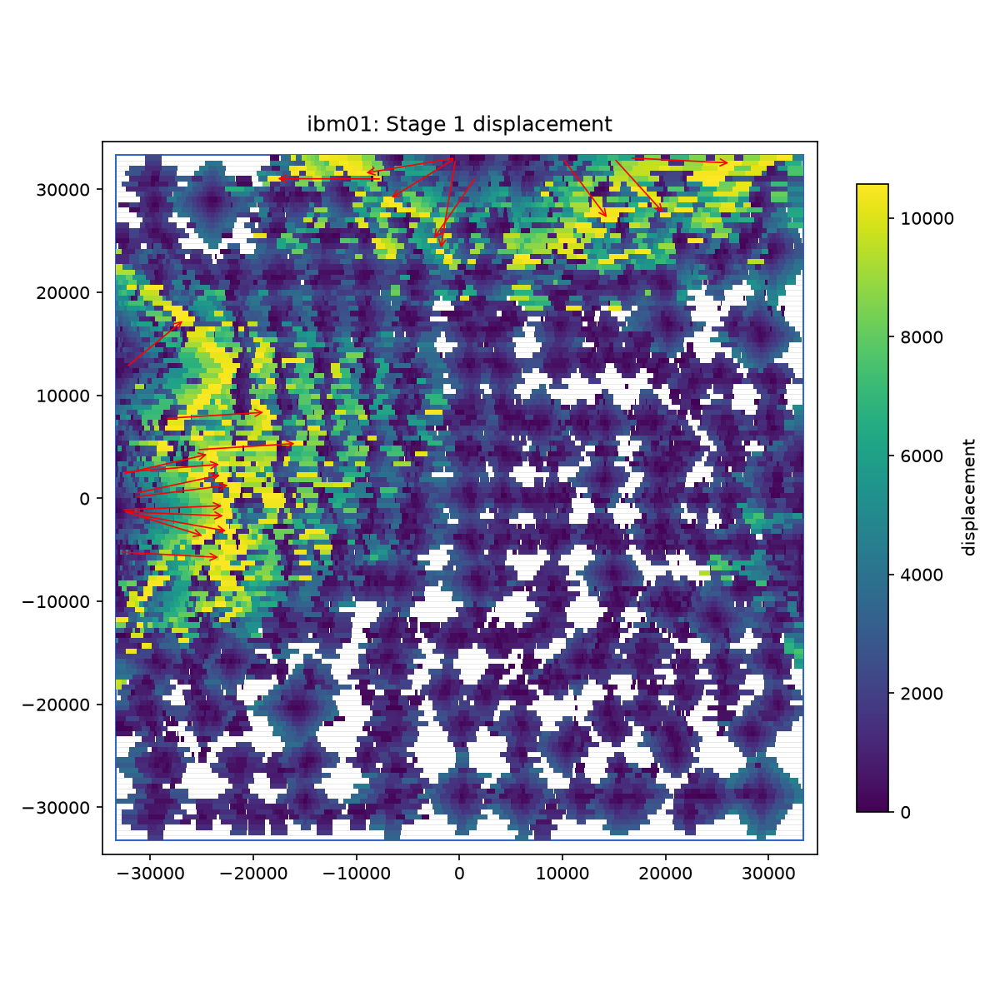
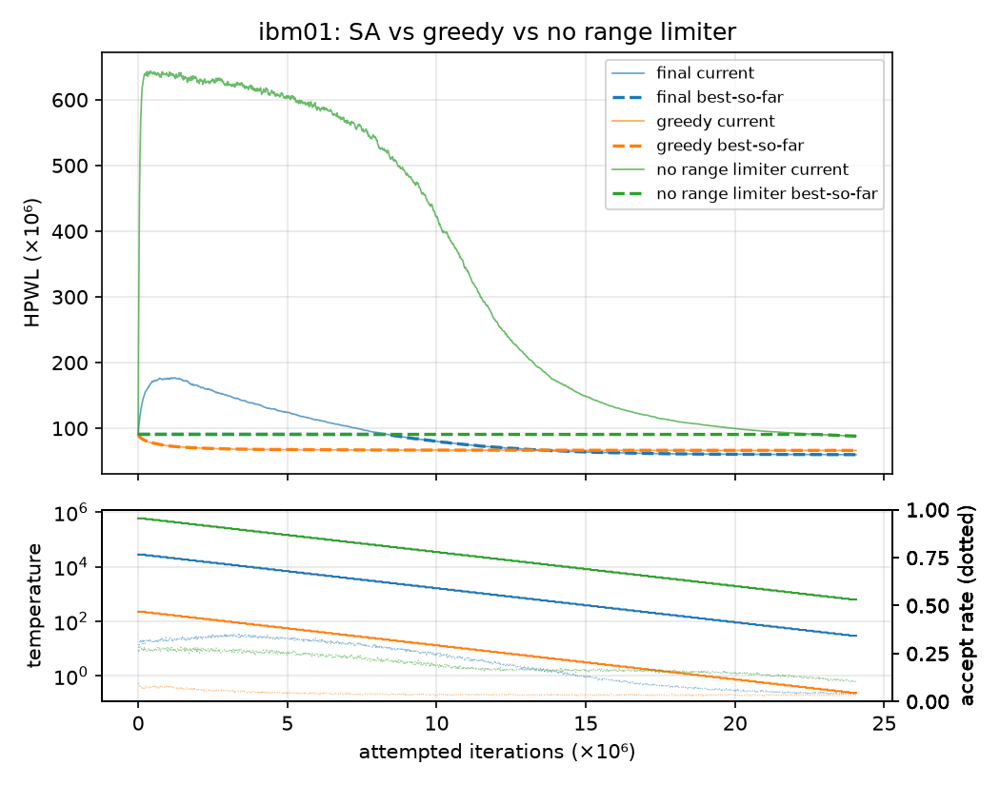

# I. Stage 1：合法化

**位置表示法。** 讀 `.scl` 時把每個 subrow 扣掉 fixed 物件蓋到的 sites，切成多個 *segment*。movable cell 的位置存成「segment 編號 + site 編號」，x = x₀ + k·spacing、y = row 座標。這樣 cell 一定在 row 上、一定對齊 site，合法性只剩「不超出 segment」與「不重疊」兩個條件，之後所有演算法都只需要維護這兩點。

**Tetris（基準，講義 L07）。** cells 依 GP 的 x 排序，每個 segment 記錄已用到的右緣，cell 放在附近 rows 中 |dx|+|dy| 最小的 max(右緣, 目標) 位置。它只會往右放，使用率 85% 的 ibm01 到最後所有 row 的右邊都滿了，**無法完成**。

**Abacus [Spindler, ISPD'08]。** 一樣依 x 排序加到 row 的最右邊，但左邊緊貼的 cells（cluster）可以整串移動。cluster 記 e（cell 數）、q = Σ(uᵢ − offsetᵢ)、w（寬度），最佳左緣 x = q/e（位移平方和最小）；新 cell 跟左邊 cluster 重疊就合併（q += q' − e'·w），可能連鎖合併。row 的選法：從最近的 row 上下展開，**cost = 新 cell 的位移 + 被推動 cells 的位移變化**，|dy| 已經大於目前最佳就停止。只算新 cell 自己的位移會讓 ibm01 的總位移多 11%、最大位移多 49%。

**位移微調。** 在 Abacus 的結果上用三種 local move（全部都維持合法）：(1) *insert*：把 cell 插進某個 segment，左右鄰居各自往外推剛好夠的距離；(2) *swap*：兩個 cell 各自放得進對方的空間就交換；(3) *evict*：位移最大的 cell 動不了時，把附近一個位移很小的 cell 拿出來讓位，那個 cell 再去找新位置。**最大位移**：反覆處理位移最大的 cell，所有被動到的 cell 都必須小於「目前最大值 − 1 site」，所以最大值單調下降；**總位移**：每個 cell 試 insert / swap，總和變小且不超過最大值就接受。兩者交替到最大值不再下降。

| 方法 | toy 總 / 最大 | ibm01 總 / 最大 | ibm05 總 / 最大 |
|---|---|---|---|
| Tetris | 60,496 / 2,913 | 失敗 | 2,606,793 / 1,027 |
| Abacus（cost = 自己的位移） | 49,701 / 2,548 | 40,796,017 / 26,571 | 1,804,388 / 282.3 |
| Abacus（cost = 總變化） | 48,977 / 2,226 | 36,759,608 / 17,783 | 1,771,547 / 330.4 |
| + insert / swap 微調 | 46,282 / 2,079 | 27,070,626 / 11,607 | 1,432,267 / 229.4 |
| **+ evict（最終）** | **46,619 / 1,988** | **27,235,501 / 10,578** | **1,431,842 / 217.6** |

微調讓 ibm01 的總位移再少 26%、最大位移少 41%。ibm01 左邊界有一塊 5.4 倍過載的熱點（圖 1），最大位移全部來自那裡；微調到最後有數百個 cell 都卡在最大值附近，要再降必須讓整片熱點一起往外移，這是一次只動一兩個 cell 的 local move 的極限。

{width=3.4in}

# II. Stage 2：模擬退火

**狀態與 cost。** 狀態是合法的 placement，cost 是總 HPWL（pin 在 cell 中心）。每個 move 都是「做完一定合法」的，所以不需要 overlap penalty，也不需要最後再合法化一次。

**Move（TimberWolf M1 / M2 的 row 版本）。** 隨機挑 cell a，選一個目標點：50% 機率在 a 的 **optimal region** 裡（a 的每條 net 去掉 a 之後的 bounding box，左右邊界各取中位數，任何一點都讓 a 自己的 HPWL 最小），50% 在 range window 內隨機。目標是空位且放得下 → a 搬過去；目標上有 cell b → 若 a 放得進 b 的空間、b 放得進 a 的空間就交換（同一 row 相鄰則直接對調順序，外緣不變）。「放得下」用每個 segment 依 x 排序的 cell 清單二分搜尋，O(log n)。

**增量計算。** 只重算 a、b 所在的 nets（net 用時間戳去重），一次 move 約 0.6 μs，ibm05 每秒約 170 萬次。

**溫度與 range limiter。** 先試做 5000 個 move，取變差 move 的平均 Δ̄，T₀ = −Δ̄ / ln 0.8；100 個溫度，等比降到 T₀/1000，總共 2000 × cell 數次嘗試。window 依 VPR 的規則每個溫度乘上 (1 − 0.44 + 接受率)，讓接受率維持在 0.44 附近；optimal-region 的目標不受 window 限制。如果測到速度不夠在時間上限內做完，就減少每個溫度的次數，但仍然降到最低溫，確保結束時是收斂的狀態。

**輸出最好的解。** 用 undo journal 記下「上次出現最佳解之後，每個 cell 第一次被移動前的位置」；出現新的最佳解就清空。結束時把 journal 還原，就得到最好的 placement，不必每次整份複製。

# III. 實驗

單執行緒、預設參數、同一個 seed。所有輸出都通過獨立的檢查器 `check_pl.py`（自己讀 `.scl` 檢查 row、site、subrow、重疊、fixed 物件）。

| bench | cells | 總位移 | 最大位移 | HPWL GP（有重疊） | HPWL legal | HPWL SA | 降低 | 時間 |
|---|---:|---:|---:|---:|---:|---:|---:|---:|
| toy | 31 | 46,619.2 | 1,987.6 | 2,698 | 101,556 | 48,054 | 52.7% | 0.0 s |
| ibm01 | 12,028 | 27,235,500.8 | 10,578.3 | 54,504,337 | 90,945,258 | 60,045,714 | 34.0% | 12.1 s |
| ibm05 | 28,146 | 1,431,841.7 | 217.6 | 10,669,961 | 11,997,198 | 10,307,273 | 14.1% | 40.7 s |

{width=4.6in}

**SA 的行為（圖 2）。** 最終設定在前 120 萬次嘗試裡 current 從 91M 升到 177M：高溫時接受大量變差的 move，cells 離開 Stage 1 為了「位移小」而選的位置；best-so-far 在前 850 萬次幾乎沒變（降不到 1%）。溫度降下來後 current 穩定下降，1370 萬次時追過貪心，最後 60.0M，比貪心的 66.5M 低約 10%。貪心一開始降得最快，450 萬次時已經離它的終點不到 2%，之後就卡在 local minimum。沒有 range limiter 時，高溫下的長距離 move 把 HPWL 打亂到 640M，到結束都回不來。

| SA 版本 | ibm01 HPWL | 相對最終 | ibm05 HPWL | 相對最終 |
|---|---:|---:|---:|---:|
| 最終（p₀=0.8、optimal region 50%、range limiter） | 60,045,714 | — | 10,307,273 | — |
| 貪心（T≈0） | 66,508,038 | +10.8% | 10,638,397 | +3.2% |
| p₀ = 0.05 / 0.3 / 0.95 | 62.8M / 61.4M / 62.6M | +4.6 / +2.3 / +4.3% | 10.46M / 10.44M / 10.28M | +1.5 / +1.2 / −0.3% |
| 沒有 optimal-region move | 81,966,186 | +36.5% | 11,178,758 | +8.5% |
| 只有 optimal-region move | 65,605,098 | +9.3% | 10,662,934 | +3.5% |
| optimal-region 也受 window 限制 | 62,280,108 | +3.7% | 10,490,062 | +1.8% |
| 沒有 range limiter | 88,221,282 | +46.9% | 11,447,454 | +11.1% |

**嘗試次數與穩定度。** 每個 cell 的嘗試次數從 125 增加到 4000，ibm01 的 HPWL 降幅從 16% 增加到 37%、ibm05 從 1% 增加到 16%，還沒飽和；預設的 2000 是時間（ibm05 約 40 秒）和品質的折衷，可以用 `--effort`、`--time` 調整。5 個不同 seed 的結果標準差：ibm01 0.45%、ibm05 0.08%。

# IV. 觀察與 trade-off

1. **最大位移由熱點決定**：Tetris 的失敗、Abacus 的長尾和微調後的「牆」都來自同一個原因，局部的容量不夠，下一步應該是 flow-based 的整片搬移。
2. **位移和 HPWL 互相衝突**：微調讓 ibm01 的位移少 26%，但 legal HPWL 從 87.3M 增加到 90.9M（Stage 1 只看位移）。不過從兩者出發跑 SA 分別得到 60.3M 和 60.0M（ibm05：10.32M 和 10.31M），微調的 HPWL 代價在 SA 之後就消失了，所以 Stage 1 專心做位移是合理的分工。
3. **SA 的價值在「方向」加上「跳脫」**：optimal-region move 給方向（拿掉它差 37%），適度的溫度讓結果比貪心再好 10%，range limiter 防止高溫時把結構打散（拿掉它差 47%）。

**工具。** `check_pl.py`（獨立合法性檢查與評分）、`plot_pl.py`（placement、位移熱圖與箭頭，圖 1）、`plot_trace.py`（SA 曲線，圖 2）、`run_experiments.py` / `make_assets.py`（一鍵重跑本報告所有表格與圖）。
